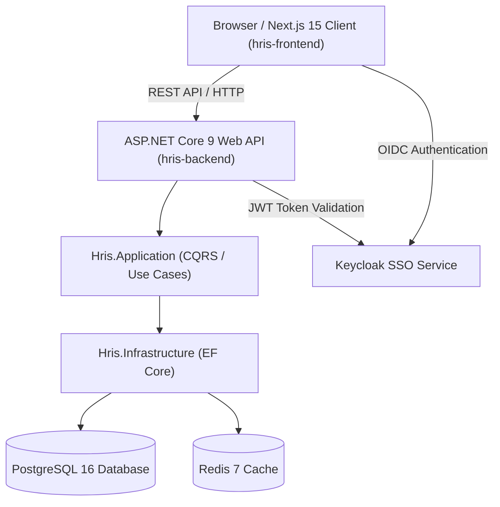

# Project Overview

HRIS Monorepo (`hris-project`) is an integrated enterprise Human Resource Information System
combining a Next.js 15 frontend client (`hris-frontend`) and an ASP.NET Core 9 Web API
backend (`hris-backend`). The platform delivers core HR operations including employee directory
management, attendance monitoring, payroll processing, onboarding/offboarding workflows, claim
reimbursements, and performance tracking. Built with modern full-stack engineering standards,
the repository provides pnpm workspace orchestration, containerized local execution via Docker
Compose, and automated multi-job CI/CD pipelines using GitHub Actions.

## Repository Structure

- `.github/`: Contains root GitHub Actions workflows (`ci-cd.yaml`) for CI testing and deployment.
- `docs/`: Diataxis-organized documentation (`00-overview/`, `01-getting-started/`,
  `02-architecture/`, `03-guides/`, `04-reference/`). See [docs/README.md](docs/README.md).
- `hris-backend/`: Holds the ASP.NET Core 9 Web API solution divided into domain and web layers.
- `hris-frontend/`: Houses the Next.js 15 web client built with React 19, Tailwind, and Radix.

## Build & Development Commands

```bash
# Install all root and workspace dependencies
pnpm install

# Run frontend (Next.js) and backend (ASP.NET Core) concurrently in development mode
pnpm dev

# Run frontend development server only
pnpm dev:client

# Run backend ASP.NET Core Web API server only
pnpm dev:backend

# Build production artifacts for both frontend and backend
pnpm build

# Build production bundle for frontend only
pnpm build:client

# Build production binaries for backend solution only
pnpm build:backend

# Run ESLint across the frontend codebase
pnpm lint:client

# Type-check TypeScript code in the frontend
pnpm --filter ./hris-frontend exec tsc --noEmit

# Run unit tests for the frontend
pnpm --filter ./hris-frontend test

# Run unit and integration tests for backend solution
dotnet test hris-backend/Hris.Backend.sln

# Launch full containerized development environment (App, API, Postgres, Redis, Keycloak)
docker compose --profile dev up --build
```

## Code Style & Conventions

- Formatting: Use Prettier and ESLint for TypeScript/React code; follow standard C# formatting.
- Indentation: 2 spaces for TypeScript, JSX, JSON, and YAML; 4 spaces for C# files.
- TypeScript Naming: `kebab-case` for component files (`clock-in-card.tsx`), `PascalCase` for React
  components (`ClockInCard`), and named exports for all non-page components.
- C# Naming: `PascalCase` for classes, methods, and properties; prefix interfaces with `I`
  (e.g., `IEmployeeService`).
- Constants & Enums: `UPPER_SNAKE_CASE` for environment variables; string literal unions for states.
- Lint Config: `eslint.config.mjs` in frontend; standard Roslyn analyzers for ASP.NET Core.
- Commit Message Template:
  ```text
  <type>(<scope>): <short summary>

  [optional body explanation]

  [optional issue/ticket reference]
  ```
  Allowed types: `feat`, `fix`, `docs`, `style`, `refactor`, `test`, `chore`.

## Architecture Notes



The monorepo separates presentation logic from backend services. The frontend (`hris-frontend`)
is a Next.js 15 App Router application utilizing SWR for client-side state revalidation and Radix/
shadcn primitives for UI components. The backend (`hris-backend`) follows Clean Architecture with
four projects: `Hris.Domain` (core entities), `Hris.Application` (business rules),
`Hris.Infrastructure` (database and external services), and `Hris.WebAPI` (HTTP endpoints).

## Testing Strategy

- Unit Tests:
  - Frontend: Jest + `@testing-library/react` with `ts-jest` for component testing.
  - Backend: xUnit / NUnit for testing domain entities and application services.
- Integration Tests:
  - Backend: `Microsoft.AspNetCore.Mvc.Testing` (`WebApplicationFactory`) for WebAPI endpoints.
  - Frontend: MSW (Mock Service Worker) for API request interception during component tests.
- E2E Tests:
  > TODO: Configure Playwright or Cypress suite for automated cross-browser end-to-end tests.
- Execution in CI:
  Root GitHub Actions workflow (`ci-cd.yaml`) executes frontend lint/build and backend test/build
  on every pull request to `main`.

## Security & Compliance

- Secrets Handling: Never commit `.env.local`, `appsettings.Development.json`, or credentials.
  Use `.env.example` as a reference template and reference GitHub Secrets in CI/CD.
- Dependency Scanning: Use `pnpm audit` for NPM packages and `dotnet list package --vulnerable`
  for NuGet dependencies. Security analysis is managed via JetBrains Qodana (`qodana.yaml`).
- Execution Safety: Production containers run with non-root user privileges.
- License & Usage: Proprietary internal enterprise codebase; unauthorized redistribution is prohibited.

## Agent Guardrails

- Restricted Files:
  - Do NOT manually modify generated lockfiles (`pnpm-lock.yaml`). Run `pnpm install` instead.
  - Do NOT directly edit generated UI primitives in `hris-frontend/components/ui/`. Use
    composition or the `shadcn` CLI tool.
  - Do NOT modify production database migration scripts without explicit human review.
- Required Reviews: Pull requests containing changes to `.github/workflows/`, security configs,
  or shared API interfaces require mandatory senior engineer sign-off.
- Verification Rule: Automated agents MUST execute `pnpm build` and `dotnet build` verification
  commands after making code changes before declaring completion.

## Extensibility Hooks

- Frontend Hooks: Custom React hooks under `hris-frontend/hooks/` and SWR fetchers.
- Backend Middleware: Custom ASP.NET Core middleware in `hris-backend/Hris.WebAPI/Middleware/`.
- Environment Variables:
  - `NEXT_PUBLIC_API_BASE_URL`: Base URL pointing to the ASP.NET Core API.
  - `ASPNETCORE_ENVIRONMENT`: Execution environment (`Development`, `Staging`, `Production`).
  - `DATABASE_URL`: PostgreSQL connection string.
  - `REDIS_URL`: Redis cache connection string.
- Feature Flags:
  > TODO: Implement centralized feature flag mechanism for runtime feature toggling.

## Further Reading

Full documentation is organized under `docs/` using the Diataxis framework. Start with the
[Documentation Index](docs/README.md) for a navigable overview of all documents.

### Overview & Project Context
- [Project Overview](docs/00-overview/project-overview.md) — Scope, objectives, and glossary
- [Stakeholders & Roles](docs/00-overview/stakeholders-and-roles.md) — RBAC role matrix
- [Release Roadmap](docs/00-overview/release-roadmap.md) — Phased release plan and SLA targets

### Getting Started
- [Prerequisites](docs/01-getting-started/prerequisites.md) — Tool versions and machine setup
- [Environment Setup](docs/01-getting-started/environment-setup.md) — Full dev environment bootstrap
- [Running the Project](docs/01-getting-started/running-the-project.md) — How to run locally

### Architecture
- [System Architecture](docs/02-architecture/system-architecture.md) — Stack, DDD, multi-tenancy
- [Security Architecture](docs/02-architecture/security-architecture.md) — Threat model, AuthN/AuthZ, encryption
- [Data Model](docs/02-architecture/data-model.md) — Entity schema and data standards
- [Integration Architecture](docs/02-architecture/integration-architecture.md) — SSO, banking, biometrics
- [Event-Driven Architecture](docs/02-architecture/event-driven-architecture.md) — Kafka events

### Development Guides
- [Development Workflow](docs/03-guides/development-workflow.md) — Branching, PRs, conventions
- [Frontend Workflow](docs/03-guides/frontend-workflow.md) — Next.js specific flow
- [Backend Workflow](docs/03-guides/backend-workflow.md) — ASP.NET Core / NestJS flow
- [Database Migration](docs/03-guides/database-migration.md) — Zero-downtime migration policy
- [Storybook & MSW](docs/03-guides/storybook-and-msw.md) — Component-first development
- [Visual Regression Testing](docs/03-guides/visual-regression-testing.md) — Playwright snapshots
- [CI/CD Pipeline](docs/03-guides/ci-cd-pipeline.md) — GitHub Actions, quality gates
- [Payroll Release Process](docs/03-guides/payroll-release-process.md) — Critical finance releases
- [Incident Response](docs/03-guides/incident-response.md) — IR triage and playbooks

### Technical Reference
- [Functional Requirements](docs/04-reference/functional-requirements.md) — FR-xxx matrix
- [Non-Functional Requirements](docs/04-reference/non-functional-requirements.md) — NFR-xxx matrix
- [API Specification](docs/04-reference/api-specification.md) — REST API, error codes, webhooks
- [Module Catalog](docs/04-reference/module-catalog.md) — All 17 HRIS modules
- [Environment Variables](docs/04-reference/environment-variables.md) — Env var reference
- [Indonesian Compliance](docs/04-reference/indonesian-compliance.md) — PPh21, BPJS, THR config
