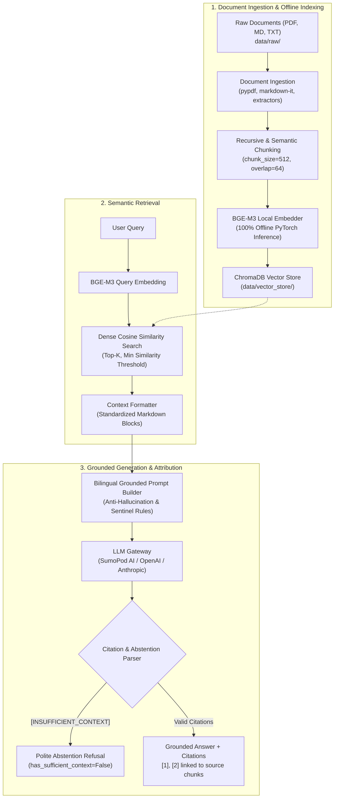

# HRIS AI Service

> **Polyglot AI Backend — Modular, Verifiable, and Air-Gapped Retrieval-Augmented Generation (RAG)**
> *Migrated 1:1 from the IOH-RAG-POC — 72/72 Tests Passing — 100% Abstention Accuracy*

---

## Overview

`apps/ai` is the dedicated Python AI backend of the HRIS monorepo, running **FastAPI** alongside the
ASP.NET Core API. It provides grounded, citation-attributed question answering over corporate HR/IT
documents (PDF, MD, TXT) with strict anti-hallucination guarantees:

- **Verifiable Grounding & Citation Attribution**: Answers are strictly generated from retrieved
  document chunks with bracketed inline references (e.g., `[1]`, `[2]`).
- **Defensive Abstention (Zero Hallucination)**: Emits a polite refusal when context is missing,
  irrelevant, or below confidence thresholds via automated `[INSUFFICIENT_CONTEXT]` detection.
- **100% Air-Gapped Local Embeddings**: Powered by `BAAI/bge-m3` running locally via PyTorch
  (`HF_HUB_OFFLINE=1`) — no document content or embeddings leave the infrastructure.
- **Plug-and-Play LLM Gateway**: Supports SumoPod AI (`https://ai.sumopod.com/v1`), standard
  OpenAI endpoints, and Anthropic Claude.

The chat UI is **not** part of this service — it will be built inside `apps/web` and consume
this API (CORS already allows `localhost:3000`).

---

## Architecture Flow



---

## Repository Structure

```text
apps/ai/
├── src/                            # Modular pipeline architecture (hexagonal)
│   ├── api/                        # FastAPI app, routers (chat, health), schemas
│   ├── ingestion/                  # Document parsing, extraction, and validation
│   ├── indexing/                   # Chunking strategies & ChromaDB vector store
│   │   └── adapters/               # BGE-M3 local embedder & Chroma store adapter
│   ├── retrieval/                  # Dense retriever, filtering, and context formatter
│   └── generation/                 # Grounded prompt builder, citations, and LLM adapters
│       └── adapters/               # SumoPod/OpenAI & Anthropic Claude generators
├── scripts/                        # Operational CLI runners & evaluation tooling
├── tests/                          # Automated Pytest suite (72 tests)
├── evaluation/                     # Benchmark datasets & results
├── data/                           # Data storage (git-ignored, starts empty)
│   ├── raw/                        # Corporate input documents (PDF, MD, TXT)
│   ├── processed/                  # Processed artifacts
│   └── cache/models/               # Local cached weights (BAAI/bge-m3)
├── docs/architecture.md            # Full architectural specification
├── .env.example                    # Environment configuration template
├── pyproject.toml                  # Project metadata & uv dependencies
└── uv.lock                         # Universal lockfile
```

---

## Quickstart

### 1. Prerequisites
- **Python 3.10+** (tested on 3.12)
- **[uv](https://docs.astral.sh/uv/)** package manager

### 2. Installation
```bash
# From the monorepo root
uv sync --directory apps/ai
```

### 3. Environment Configuration
```bash
cd apps/ai
cp .env.example .env
```

Edit `.env` and set your LLM credentials:
```dotenv
LLM_PROVIDER=openai
LLM_BASE_URL=https://ai.sumopod.com/v1
LLM_API_KEY=sk-your-sumopod-api-key-here
LLM_MODEL=gpt-4o-mini
```

> [!NOTE]
> `HF_HUB_OFFLINE=1` forces a fully offline model load from `data/cache/models/`. On the **very
> first run** the BGE-M3 weights (~2GB) must be downloaded once — temporarily comment out
> `HF_HUB_OFFLINE` and `TRANSFORMERS_OFFLINE`, then restore them afterwards.

---

## Running the API

From the monorepo root:
```bash
pnpm dev:ai
```

Or directly:
```bash
uv run --directory apps/ai uvicorn src.api.main:app --port 8000 --reload
```

- **API & Swagger**: [http://localhost:8000/docs](http://localhost:8000/docs)
- **Health Check**: [http://localhost:8000/api/health](http://localhost:8000/api/health)

---

## Operational CLI Commands

### 1. Batch Document Indexing
Place corporate documents in `apps/ai/data/raw/`, then:
```bash
pnpm ai:index
# equivalent to:
uv run --directory apps/ai python scripts/index_all_documents.py --data-dir data/raw --collection rag_documents_ioh
```
*Options:* `--data-dir`, `--collection`, `--reset` (clear collection before indexing).

### 2. Interactive RAG Query Runner
```bash
uv run --directory apps/ai python scripts/run_rag_pipeline.py \
  --query "Berapa hari kuota hak cuti tahunan bagi karyawan tetap?"
```
*Options:* `-q/--query`, `-k/--top-k` (default 4), `-t/--threshold` (default 0.3),
`-c/--collection`, `--json`.

### 3. Automated End-to-End Evaluation
```bash
uv run --directory apps/ai python scripts/run_e2e_evaluation.py \
  --test-cases evaluation/test_cases.json --top-k 4
```

### 4. Running Automated Tests
```bash
pnpm test:ai
# equivalent to:
uv run --directory apps/ai pytest
```

> [!WARNING]
> `scripts/run_ingestion_pipeline.py` is a legacy POC smoke test that expects three fixture files
> (`sample_doc.txt`, `sample_notes.md`, `sample_report.pdf`) which were **intentionally not
> migrated** (fresh-data decision). Use `index_all_documents.py` with your own documents instead.

---

## Core Principles & Guarantees

1. **Modular Decoupling** — Ingestion, indexing, retrieval, and generation interact solely through
   typed abstract interfaces; any component can be replaced without modifying others.
2. **Grounding & Citation Attribution** — Every fact in a response cites its source chunk (`[1]`);
   fabricated citations are rejected.
3. **Explicit Context Abstention** — If retrieved chunks do not contain the answer, the LLM emits
   `[INSUFFICIENT_CONTEXT]`, resulting in a transparent refusal.
4. **Offline Data Boundary** — Embedding models run locally; no document content is sent to
   third-party vector APIs.
5. **Test-Driven Integrity** — Zero regression policy; every feature is covered by unit, contract,
   and integration tests.

For full architectural specifications, see [`docs/architecture.md`](docs/architecture.md).
