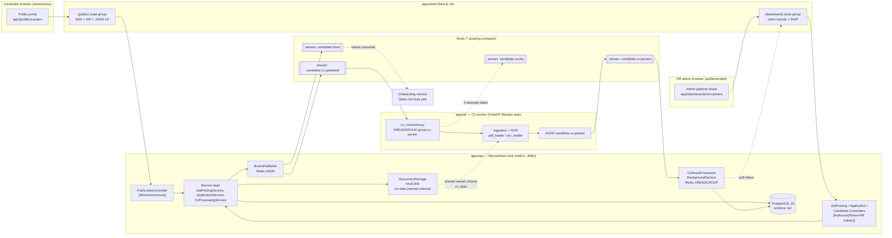

# Recruitment ATS Architecture

This document is the single, consolidated implementation blueprint for the Recruitment / Applicant Tracking System (ATS) slice of the HRIS monorepo. It replaces the six divergent design drafts that emerged from parallel analysis and resolves their contradictions (broker choice, worker host, DbContext identity, auth timing, endpoint paths, contracts strategy) into one buildable plan. The system spans a standalone Next.js 15 frontend microservice (`apps/recruitment-web` on port `:3001`) hosting both the public, unauthenticated candidate portal (`apps/recruitment-web/app/(public)/careers/*`) and the authenticated HR-admin pipeline board (`apps/recruitment-web/features/recruitment/*`), an independent .NET 9 5-layer backend microservice (`apps/api/src/Services/Recruitment/` on port `:8083`), an asynchronous CV-parsing worker that lives inside the existing Python AI service (`apps/ai`), and a durable event hand-off that triggers downstream onboarding on hire. It is written for an incremental solo learner: every phase ends in a runnable, verifiable increment, and every risky or unproven claim is called out as an explicit caveat rather than hidden.

> **Read this first.** Four decisions in this plan deliberately shape the architecture for clean service isolation and local developer ergonomics:
> 1. **Standalone Web UI & Backend Microservices.** The Recruitment/ATS UI runs as its own isolated Next.js 15 app (`apps/recruitment-web` on `:3001`) decoupled from the main HRIS client (`apps/web` on `:3000`), and communicates with the dedicated Recruitment backend microservice (`hris-recruitment-be` on `:8083`).
> 2. **No Redpanda/Kafka in the default stack.** The durable async hand-off uses **Redis Streams** on the Redis 7 container that already exists. Redpanda is retained only as an optional, isolated lab track (Phase 7).
> 3. **No new `apps/cv-worker/` container.** The CV consumer runs inside `apps/ai`, reusing its ingestion code and its FastAPI `lifespan` hook.
> 4. **No `@hris/contracts-recruitment` package yet.** The frontend continues to hand-roll DTOs + Zod, matching every existing feature. Contracts integration is deferred until the generated types are actually consumed.
>
> The "Async CV pipeline" section still specifies the Kafka/Redpanda topic names and the event envelope, so the flow is migration-ready if the lab track is ever promoted.

---

## 1. Goals / Non-goals

### Goals

- **G1 — Public career site.** Anonymous candidates can browse published job postings and submit an application with a CV upload, with SEO-correct server-rendered pages and a per-application status page. (FR-ATS-001, FR-ATS-005)
- **G2 — Configurable pipeline.** HR admins manage job postings and move applicants through Sourcing → Screening → Interview → Offer → Hired, with per-job stage configuration. (FR-ATS-002)
- **G3 — Async CV processing.** Uploaded CVs are parsed off the request path (202 Accepted + polling), reusing the existing AI ingestion pipeline; results are written back to the application record.
- **G4 — Durable hire hand-off.** A `candidate.hired` event is emitted exactly once per hire, in the documented envelope, so a future Onboarding consumer can start provisioning. (module-catalog §3–4)
- **G5 — One coherent architecture.** A single data model, a single broker, a single auth posture, and a single FE↔BE endpoint contract, with all known risks made explicit.

### Non-goals (explicitly out of scope for the first release)

- **N1 — Calendar sync (FR-ATS-003).** `interview.calendar_event_id` is modeled but no Google/Microsoft OAuth flow, token refresh, or webhook push is built. Deferred to a follow-up.
- **N2 — Offer templating + e-sign (FR-ATS-004).** `offer.esign_ref` is modeled but no PDF templating engine or e-sign provider integration is built.
- **N3 — Custom application forms (FR-ATS-001, partial).** The apply form is a fixed schema; a form-definition entity is not introduced.
- **N4 — Fuzzy dedup (FR-ATS-005, partial).** Deterministic email/phone dedup only. `pg_trgm` fuzzy matching, merge/undo flow, and UI are deferred.
- **N5 — Multi-tenancy / RLS.** No entity carries a real `tenant_id` today and RLS is aspirational. The envelope's `tenant_id` is populated with a constant `"default"`; row-level tenancy is deferred.
- **N6 — Real IdP / MFA.** Keycloak is wired as an OIDC issuer in Phase 6, but MFA, OPA/ABAC, and RLS remain future work.
- **N7 — Object storage, malware scanning, retention policy.** Local disk + a shared volume for Phase 1–5; AV scanning, encryption-at-rest, consent capture, and retention/deletion are Phase 6 hardening.
- **N8 — CD / auto-deploy.** The CI pipeline stops at image push; there is no deploy job, so migrations are a documented manual step.

---

## 2. End-to-end architecture



**Narrative.** A candidate opens a public job page (server-rendered, indexed), submits a multipart application with a CV. `PublicJobsController` validates and persists the application + document (`PENDING`), writes the file to shared disk, and `XADD`s a `candidate.cv.uploaded` event to Redis, returning **202** with a tracking token. The Python worker (inside `apps/ai`) reads from the stream group, loads the file from the shared volume, extracts text (with OCR fallback), and `XADD`s `candidate.cv.parsed`. A .NET `BackgroundService` in the recruitment host consumes that result and flips the document to `READY`. The candidate's status page polls `GET /api/v1/public/applications/{token}`; the admin board polls document status and renders a `Badge`. On hire, the admin endpoint persists `hired_at` and emits `candidate.hired` — currently a dangling contract, since no onboarding backend consumer exists (see §13).

---

## 3. Data model

**Storage:** the existing `postgres:16` container (`infra/docker-compose.yml`), a dedicated schema **`ats`** (isolated from Master's default schema + `tblm_` prefix). EF Core **migrations** (net-new tooling — see caveat) with a separate history table `__EFMigrationsHistory_ats` in schema `ats`. Table prefix `tblt_` (transactional), snake_case columns via fluent `HasColumnName`, matching `hris-be.database/ApplicationDbContext.cs:21-79`. Audit block on every table: `status=1, created_by="system", created_at=UtcNow, modified_by?, modified_at?, is_deleted=false`. IDs are `int` identity (matches `Employee.Id`). Enums stored as short strings via `HasConversion<string>()` so C#/TS literal unions stay aligned.

**DbContext identity (resolved contradiction):** keep the existing class name **`RecruitmentDbContext`** in `hris-recruitment-be.database/RecruitmentDbContext.cs`. Do **not** rename it to `ApplicationDbContext` — that name is already taken by Master, and renaming adds churn with no benefit.

### Entities

| Entity | Table | Key fields | FR |
|---|---|---|---|
| `JobPosting` | `tblt_job_postings` | id, title, description, department, location, employment_type, status, headcount, salary_min, salary_max, currency, seo_slug, seo_meta_title, seo_meta_description, logo_path, theme, opened_at, closed_at, published_at, audit | 001 |
| `JobStage` | `tblt_job_stages` | id, job_posting_id FK, name, stage_type, sequence, is_active, audit | 002 |
| `Candidate` | `tblt_candidates` | id, full_name, email, phone, source, audit | 005 |
| `Application` | `tblt_applications` | id, job_posting_id FK, candidate_id FK, current_stage_id FK, status, applied_at, score, notes, hired_at, audit | 002 |
| `ApplicationDocument` | `tblt_application_documents` | id, application_id FK, doc_type, file_name, storage_path, mime_type, size_bytes, content_hash, parse_status, extracted_text, parsed_json, error_code, attempt_count, audit | 001, 003 |
| `Interview` | `tblt_interviews` | id, application_id FK, stage_id FK, scheduled_at, duration_min, mode, calendar_provider, calendar_event_id, interviewer_emails, status, audit | 003 |
| `Offer` | `tblt_offers` | id, application_id FK, template_id, content, salary, currency, status, esign_ref, sent_at, responded_at, audit | 004 |
| `ApplicationSubmission` | `tblt_application_submissions` | id, idempotency_key (unique), application_id FK, request_hash, response_json, created_at | — |

**Single source of truth for names (resolved contradictions):** `JobStage` (not `PipelineStage`), `ApplicationDocument` (not `CandidateDocument`), and `ApplicationSubmission` is added to hold the idempotency key and the replayable 202 body.

### Enums (short strings)

- `EmploymentType`: `FULL_TIME | PART_TIME | CONTRACT | INTERN`
- `JobStatus`: `DRAFT | OPEN | CLOSED | ARCHIVED`
- `PipelineStageType`: `SOURCING | SCREENING | INTERVIEW | OFFER | HIRED`
- `ApplicationStatus`: `APPLIED | SCREENING | INTERVIEW | OFFER | HIRED | REJECTED | WITHDRAWN`
- `UploadParseStatus`: `PENDING | PROCESSING | READY | FAILED`
- `InterviewStatus`: `SCHEDULED | RESCHEDULED | COMPLETED | CANCELLED`
- `OfferStatus`: `DRAFT | SENT | ACCEPTED | DECLINED | EXPIRED`

**Invariant (resolved redundancy):** `Application.status` is authoritative; `current_stage_id` must always point at a `JobStage` whose `stage_type` is consistent with `status`. Enforce in `ApplicationService.MoveStage` with `ERR_INVALID_TRANSITION`; do not let the two fields drift.

### Indexes

- Unique `candidates(email)` **filtered `WHERE is_deleted = false`**; index `candidates(phone)`.
- Unique `applications(job_posting_id, candidate_id)`; index `(job_posting_id, status)`.
- Unique `job_stages(job_posting_id, sequence)`; unique `job_postings(seo_slug)`.
- Index `application_documents(application_id)`, `interviews(application_id)`, `interviews(scheduled_at)`, `offers(application_id)`.
- Unique `application_submissions(idempotency_key)`.

**Stage reordering caveat:** the unique `(job_posting_id, sequence)` constraint means reordering stages must use a two-phase temp-sequence write (or a deferred constraint). Not implemented in Phase 1; documented as a known limitation.

### File storage

`IDocumentStorage` (in `hris-recruitment-be.lib/Storage/`) with a `LocalDiskStorage` adapter. Path convention: `/cv-data/{yyyy}/{MM}/{applicationId}/{guid}.{ext}` — **outside the repo working tree**, on the `cv_data` named volume mounted into **both** the recruitment host and `apps/ai` (this fixes the "worker cannot read the file" blocker). The DB stores only the relative path, mime, size, and `content_hash`. Files are **never** served statically; retrieval goes through an authenticated streaming endpoint that forces `Content-Disposition: attachment` + `X-Content-Type-Options: nosniff`.

---

## 4. API surface

All responses use `DefaultDtoResponse<T>` (`Status`, `List<T> Data`, `Message`, `Total`). **Envelope caveat:** `Data` is always a list, so single-object endpoints return `data[0]`; the frontend must read `resp.data[0]` for detail/status responses.

### Public endpoints (anonymous)

| Method | Path | Body / params | Success | Notes |
|---|---|---|---|---|
| GET | `/api/v1/public/jobs` | `Offset`, `Limit`, `Search` | 200 `DefaultDtoResponse<PublicJobDto>` | Published jobs only |
| GET | `/api/v1/public/jobs/{slug}` | — | 200 `PublicJobDetailDto` / 404 | SEO fields included |
| POST | `/api/v1/public/jobs/{id}/applications` | `multipart/form-data` + `Idempotency-Key` header | **202** `{ applicationId, trackingToken, status: "RECEIVED" }` | CV upload; rate-limited |
| GET | `/api/v1/public/applications/{token}` | — | 200 `ApplicationStatusDto` | Capability URL; no PII beyond status |

**202 + polling contract (matches `docs/04-reference/api-specification.md:72-87`):** `POST .../applications` returns `202 Accepted` immediately after persisting the application and document as `PENDING` and enqueuing the CV event. The response body carries `applicationId`, an opaque `trackingToken`, and `status: "RECEIVED"`. The client polls `GET /api/v1/public/applications/{token}` (SWR `refreshInterval`, e.g. 3000 ms, backing off to 10 s after 60 s) until `status` is terminal (`READY` / `FAILED` / pipeline stage) or the user leaves. Replaying the same `Idempotency-Key` returns the **original** 202 body from `tblt_application_submissions`.

### Admin endpoints (`[Authorize(Roles="HR Admin")]`)

| Method | Path | Notes |
|---|---|---|
| GET | `/api/v1/JobPosting?Offset&Limit&Sort&Order&Search` | 200 |
| GET | `/api/v1/JobPosting/{id}` | 200 / 404 / 400 |
| POST | `/api/v1/JobPosting` | 201 `CreatedAtAction` |
| PUT | `/api/v1/JobPosting/{id}` | 200 |
| DELETE | `/api/v1/JobPosting/{id}` | 200 (soft delete) |
| POST | `/api/v1/JobPosting/{id}/publish` | 200 |
| POST | `/api/v1/JobPosting/{id}/unpublish` | 200 |
| GET | `/api/v1/JobPosting/{id}/stages` | 200 |
| PUT | `/api/v1/JobPosting/{id}/stages` | 200 |
| GET | `/api/v1/Application?JobPostingId&Stage&Offset&Limit&Search` | 200 |
| GET | `/api/v1/Application/{id}` | 200 / 404 |
| POST | `/api/v1/Application/{id}/move-stage` | 200 |
| POST | `/api/v1/Application/{id}/reject` | 200 |
| POST | `/api/v1/Application/{id}/hire` | 200 — emits `candidate.hired` |
| GET | `/api/v1/Application/{applicationId}/documents/{documentId}` | 200 file stream (`Content-Disposition: attachment`) |
| GET | `/api/v1/Candidate?Offset&Limit&Search` | 200 |
| GET | `/api/v1/Candidate/{id}` | 200 / 404 |

**Controller conventions (copy `EmployeeController.cs` exactly):** `[ApiController]` + `[Route("api/v1/[controller]")]`, ctor-inject `I*Service`, return `Task<ActionResult<DefaultDtoResponse<TDto>>>`, no `try/catch`; `Status=="FAILED"` → `NotFound(resp)` only when `Message["code"]=="ERR_NOT_FOUND"`, else `BadRequest(resp)`; POST → `CreatedAtAction(nameof(GetX), new { id = Data[0].Id }, resp)`.

**Canonical FE↔BE contract (resolved contradiction).** The frontend **must** call the exact paths above. The prior drafts disagreed (`PATCH .../stage` vs `POST .../move-stage`; `PATCH .../publish {published}` vs `POST .../publish`; `/api/v1/careers/...` vs `/api/v1/public/...`). The canonical form is the **POST verb form** and the **`/api/v1/public/...`** namespace.

**Error codes:** reuse `ERR_NOT_FOUND`, `ERR_DUPLICATE_EMAIL`, `ERR_INTERNAL`; add `ERR_INVALID_STAGE`, `ERR_JOB_NOT_PUBLISHED`, `ERR_ALREADY_HIRED`, `ERR_INVALID_TRANSITION`, `ERR_FILE_TOO_LARGE`, `ERR_UNSUPPORTED_FILE`.

**Upload hardening (Phase 4 minimum):** allow `pdf/doc/docx`; ≤5 MB; sniff magic bytes (not extension/MIME alone); reject on mismatch. **Enumeration caveat:** on duplicate email/phone, silently reuse the existing candidate rather than returning `ERR_DUPLICATE_EMAIL` (avoids leaking candidate existence).

---

## 5. Async CV pipeline

### Broker decision (resolved contradiction)

The drafts split between Redis pub/sub and Redpanda/Kafka. **Decision: Redis Streams** on the existing `redis:7-alpine` container.

- Redis Streams give durability (append-only log), consumer groups (`XREADGROUP`), pending-entry-list (PEL) retry via `XCLAIM`, and an explicit DLQ — the properties the designs used to justify Redpanda.
- It adds **zero new infrastructure, zero new container, and zero new client dependency** beyond `StackExchange.Redis` (.NET, already in the ecosystem) and `redis` (Python, tiny).
- The existing CRM `EventBusService` (`apps/crm/src/events/event-bus.service.ts`) is fire-and-forget and unsuitable; this plan does **not** reuse it. It introduces a new envelope-aware publisher.

**Redpanda is an optional lab (Phase 7), not part of the default stack.** The topic/stream names and envelope below are Kafka-compatible, so promoting to Redpanda later is a transport swap, not a redesign. **Caveats if you ever do:** pin the image tag (the repo pins `postgres:16`, `redis:7-alpine`, `keycloak:24.0`; `:latest` breaks reproducibility), add seastar flags (`--smp 1 --memory 1G --overprovisioned --node-id 0 --check=false`) and a data volume (a "plain image like redis" fails on constrained machines), and enable SASL/TLS/ACL (an open `9092` lets any LAN host forge `candidate.hired`).

### Streams / topics

| Stream (Kafka topic name) | Producer → Consumer | Payload `data` |
|---|---|---|
| `candidate.cv.uploaded` | .NET `CvProcessingService` → Python worker | `applicationId, documentId, storagePath, mimeType, attempt` |
| `candidate.cv.parsed` | Python worker → .NET `CvResultConsumer` | `applicationId, documentId, parsedJson, extractedText, confidence` |
| `candidate.cv.failed` | Python worker → .NET `CvResultConsumer` | `documentId, errorCode, attempt` |
| `candidate.cv.dlq` | Python worker (after 3 attempts) | full envelope + last error |
| `candidate.hired` | .NET `ApplicationService` → future onboarding consumer | `applicationId, candidateId, jobPostingId, hiredAt` |

### Event envelope

```json
{
  "id": "uuid",
  "type": "candidate.cv.uploaded",
  "occurred_at": "2026-10-15T09:00:00Z",
  "tenant_id": "default",
  "entity_id": "42",
  "correlation_id": "uuid",
  "causation_id": "uuid-or-null",
  "version": 1,
  "data": { "applicationId": 42, "documentId": 77, "storagePath": "2026/10/42/abc.pdf", "mimeType": "application/pdf", "attempt": 1 }
}
```

**Caveat (unrefuted):** the only real producer in the repo (`apps/crm/src/crm/crm.service.ts:158`) emits a raw ad-hoc payload with **no** envelope. This envelope is aspirational relative to that precedent; it matches the *documented* contract in `docs/02-architecture/event-driven-architecture.md`, not the *implemented* one. `tenant_id` is a constant `"default"` because no entity carries a real tenant column.

### Producer (.NET)

`IEventPublisher` + `RedisEventPublisher` (StackExchange.Redis) in `hris-recruitment-be/Events/`. `CvProcessingService` persists the document as `PENDING`, writes the file to shared disk, then `XADD`s `candidate.cv.uploaded`. **Producer caveat:** DB write and `XADD` are non-atomic (no outbox). A crash between them orphans a `PENDING` document; mitigate with a **`PENDING`-older-than-N-minutes sweeper** (`BackgroundService` that re-`XADD`s stale `PENDING` documents). A transactional outbox is deferred.

### Consumer (Python, inside `apps/ai`)

`apps/ai/src/worker/cv_consumer.py`, started/stopped from the existing (currently no-op) `lifespan` in `apps/ai/src/api/main.py:19-24`. It `XREADGROUP`s group `cv-parser` (consumer name = hostname), resolves `storagePath` on the shared `cv_data` volume, runs `DocumentIngestionService` + `pdf_loader`/`ocr_loader`, and `XADD`s `candidate.cv.parsed` (or `failed`/`dlq`). **Consumer caveats:** the connection must retry with backoff and **must not block FastAPI startup** if Redis is down; add `redis` to `apps/ai/pyproject.toml`. **Idempotency:** keyed on `documentId` — the .NET result consumer upserts by `documentId` (mirroring PSA's `findFirst` guard at `apps/crm/src/psa/psa.service.ts:24`), so duplicate deliveries are no-ops.

### Consumer (.NET, result write-back)

`CvResultConsumer : BackgroundService` in the recruitment host, `XREADGROUP` on `candidate.cv.parsed`/`candidate.cv.failed`; on `parsed` it sets `parse_status=READY` + `parsed_json`/`extracted_text`; on `failed` it sets `FAILED` + `error_code`. **This consumer is net-new** — no Kafka/stream consumer precedent exists in `apps/api`; the prior drafts only specified a producer and left this hole.

### Retry / DLQ / state machine

State machine: `PENDING` (upload persisted) → `PROCESSING` (worker claims) → `READY` (parsed) | `FAILED` (3 attempts exhausted). Retry uses the stream PEL: on failure the worker does not `XACK`; after a visibility timeout it `XCLAIM`s and increments `attempt`. After `attempt > 3` it `XADD`s `candidate.cv.dlq`, sets `FAILED`, and `XACK`s.

**OCR caveat:** `apps/ai/src/ingestion/adapters/pdf_loader.py:73-77` raises `EmptyDocumentError` on image-only PDFs; OCR is **net-new** (no `pytesseract`/`PaddleOCR` dependency exists). Phase 5 adds `adapters/ocr_loader.py`; until then, image-only CVs terminate as `FAILED` with `ERR_UNSUPPORTED_FILE`, which is an acceptable, explicit outcome.

---

## 6. Frontend

### Candidate portal (public, SEO) — `apps/web/app/(public)/careers/*`

Route group `(public)` is a **sibling of `(dashboard)`**, so it never mounts `SidebarProvider`/Topbar or reads `localStorage.userRole`. Root `app/layout.tsx` still wraps it (Geist fonts, Vercel Analytics). Feature code lives in `features/careers/**`, mirroring `features/employee/**` and `features/onboarding/**`.

- `app/(public)/layout.tsx` — candidate shell (logo, header, footer; no sidebar).
- `app/(public)/careers/page.tsx` — job list. **Build-time-fetch caveat:** `frontend-ci` runs `next build` with **no API running**, and no existing page does a server-side fetch. Use `export const dynamic = "force-dynamic"` and wrap the fetch in try/catch returning an empty list, so the build cannot fail. Prefer client-side SWR for the list initially; enable ISR (`revalidate`) only once CI provides a stub API.
- `app/(public)/careers/[slug]/page.tsx` — detail + `generateMetadata` + JobPosting JSON-LD (`<script type="application/ld+json">`).
- `app/(public)/careers/[slug]/apply/page.tsx` — apply form island.
- `app/(public)/careers/application/[token]/page.tsx` — status page with SWR `refreshInterval` polling.
- `app/sitemap.ts` + `app/robots.ts` — new. **Caveat:** `robots.ts` must `Disallow` `/careers/apply` and `noindex` `/careers/application/*` so capability URLs never leak via search engines.

Feature `features/careers/`:
- `api/use-careers.ts` — SWR `useJobPostings`, `useJobPosting(slug)`, `submitApplication`, `useApplicationStatus(token)` (with `refreshInterval`).
- `types/careers.ts` — `JobPosting`, `CreateApplicationDto`, `ApplicationStatus` unions + Zod `applyFormSchema` + `statusLabel`.
- `components/job-list.tsx`, `job-detail.tsx`, `apply-form.tsx`, `cv-upload.tsx`, `application-status.tsx`.
- `README.md`.

**Multipart caveat (resolved):** `apps/web/lib/api-client.ts` hardcodes `Content-Type: application/json`, and `fetch` **cannot** report upload progress. Add `uploadFile()` that uses `XMLHttpRequest` with `FormData` (do **not** set the header manually). No file-input primitive exists in `components/ui/`; add `cv-upload.tsx` (do not edit primitives). Because the browser posts **directly** to .NET (not through a Next route handler), the 1 MB body limit does not apply; 5 MB CVs work.

### Admin UI (pipeline board) — `apps/web/features/recruitment/*` + `app/(dashboard)/recruitment/page.tsx`

Mirror the existing feature layout exactly (one `api/use-recruitment.ts`, not three hook files — matches `use-employees.ts` granularity). Hand-roll DTOs + Zod in `types/recruitment.ts` (matches `features/employee/types/employee.ts`). Reuse `DataTableSearch`, `DataTablePagination`, `DataTableSkeleton`, `Badge`, `Sheet`, `AlertDialog`.

- `components/job-posting-table.tsx` — Card+Table, toolbar, row `DropdownMenu` (View/Edit/Delete), publish `Switch`.
- `components/job-posting-form-dialog.tsx` — create/edit, `safeParse`, per-field errors, `isSubmitting`.
- `components/pipeline-board.tsx` — stage columns (`Sourcing→…→Hired`) with **button/dropdown move, not drag-and-drop** (no DnD primitive exists).
- `components/applicant-table.tsx` — filters (job/stage/search); rows open the drawer.
- `components/applicant-detail-drawer.tsx` — `Sheet`; parsed CV fields, original-file link (`<a download href="/api/v1/Application/{appId}/documents/{docId}">` — **authenticated endpoint**, never a raw storage path), notes, Hire `AlertDialog` confirm, CV parse `Badge` polled via SWR.
- `app/(dashboard)/recruitment/page.tsx` — Server Component shell with `Tabs` (Job Postings | Pipeline | Applicants).
- `app/api/recruitment/route.ts` (+ `[id]/route.ts`) — mock Route Handlers (pattern: existing `app/api/processes/`). **Caveat:** point mocks at the same `/api/v1/...` paths the SWR hooks call, to avoid repeating the onboarding `/api/processes` vs `/api/v1/Onboarding` inconsistency.

**Auth caveat:** the admin UI is UI-gated only. Do not rely on `localStorage.userRole`; real enforcement lands in Phase 6.

---

## 7. Auth & RBAC

**Current reality (verified):** no `AddAuthentication`/`AddJwtBearer`/`[Authorize]` anywhere in `apps/api`; `UseAuthorization()` in `Master/hris-be/Program.cs:42` is a no-op; `Hris.TokenValidation` is an empty stub; the web login sets `localStorage.userRole` after a fake timeout; there is no `middleware.ts`; CORS is `AllowAll` on Master and **absent entirely** on the recruitment host.

**Target posture (single, resolved stance — the drafts disagreed on "deferred vs now"):**

- **Protected by default.** In `hris-recruitment-be/Program.cs`, register `AddHrisAuth()` (from the filled `Hris.TokenValidation` stub) with a **fallback policy `RequireAuthenticatedUser`**. Admin controllers carry `[Authorize(Roles="HR Admin")]`; public controllers opt out with `[AllowAnonymous]` on `PublicJobsController`.
- **Admin = authenticated.** Internal ATS surfaces (candidate PII, CV download, hire) require a valid Keycloak-issued JWT with the `HR Admin` role.
- **Candidate = anonymous.** Public job/apply/status endpoints are explicitly `[AllowAnonymous]`.
- **Frontend split.** `(dashboard)` routes are authenticated; `(public)` routes are anonymous. `lib/api-client.ts` attaches `Authorization: Bearer <token>` when a token exists (no-op for anonymous calls). `middleware.ts` (net-new) guards `(dashboard)` server-side, replacing the cosmetic `localStorage` gate.
- **Keycloak.** Commit a real realm import at `infra/keycloak/realm-hris.json` (roles `HR Admin`; clients `web` PKCE public + `api` confidential) and mount it into the `keycloak:24.0` service. Validate issuer/audience, refresh JWKS, and allow clock skew.

**Ordering (blocker, from the critique):** the auth boundary **must** exist before the public upload endpoint ships. Phases 0–1 establish `AddHrisAuth` + fallback policy; the public upload lands in Phase 4. **Caveat:** a `RequireAuthenticatedUser` fallback can 401 the whole app if `[AllowAnonymous]` scoping is wrong — cover it with an explicit anonymous-endpoint test list.

---

## 8. Infra / Docker / CI / Contracts

### Docker Compose (`infra/docker-compose.yml`)

- **Add `recruitment` service.** `build: { context: ../apps/api, dockerfile: src/Services/Recruitment/hris-recruitment-be/Dockerfile }`, `image: hris-recruitment:latest`, `ports: ["8083:8083"]`, `environment: ASPNETCORE_URLS=http://+:8083`, `ConnectionStrings__DefaultConnection=Host=db;...`, `REDIS_URL=redis://redis:6379`, `depends_on: [db, redis]`, `networks: [hris]`, `profiles: ["dev","prod"]`. **Resolved contradiction:** a **dedicated Dockerfile** for the recruitment host (not extending `apps/api/Dockerfile`, which is hardcoded to `Services/Master/hris-be`), still using the app-dir context like the existing api image.
- **Add `cv_data` named volume**, mounted into **both** `recruitment` (`/cv-data`) and `ai` (`/cv-data`) — this is what makes the async flow functional (the worker must be able to read the file).
- **No `redpanda` service in the default stack** (Phase 7 lab only).
- **Add healthchecks** for `recruitment` and (optionally) `ai`, and convert `depends_on` to `condition: service_healthy` for the recruitment→db dependency, to remove startup races.

### Dockerfile

`apps/api/src/Services/Recruitment/hris-recruitment-be/Dockerfile` — dotnet SDK → aspnet runtime, explicit csproj COPY for restore (mirror `apps/api/Dockerfile`), non-root user, `EXPOSE 8083`. **Caveat:** the recruitment host has **no `appsettings.json`** today (only `launchSettings.json`); create one that reads config from env only — **never** copy Master's pattern (`hris-be/appsettings.json:3` contains live RDS credentials).

### CI (`.github/workflows/ci-cd.yaml`)

- **Recruitment build:** `Hris.Backend.sln` already includes the Recruitment projects (added by `scripts/create-service.ps1`), so **`backend-ci` already builds it** — do **not** add a redundant `recruitment-ci` job that repeats `dotnet restore/build`. If integration tests need Postgres, add a `services: postgres` container to `backend-ci` (or a focused `recruitment-integration` job that does something the sln build does not).
- **Worker tests:** the CV consumer lives in `apps/ai`, so its tests run under the existing **`ai-service-ci`** job (`uv sync --frozen --directory apps/ai` + pytest). **No `worker-ci` job** (resolved contradiction — there is no separate worker app).
- **Build-push:** add `hris-recruitment:latest` (context `./apps/api`, **explicit `file:`** pointing at the recruitment Dockerfile — otherwise it defaults to Master's) to the existing `docker-build-push` job. No new `needs` entry beyond what already gates that job.
- **Contracts drift:** leave the existing Master-only `contracts-drift` job untouched. Do **not** regenerate into `packages/contracts/openapi/swagger.json` from the recruitment host (that would clobber Master's snapshot). **Caveat:** `contracts-drift` runs the host headless; therefore the recruitment host must **not** migrate-on-startup (see below).

### Contracts (`packages/contracts/`)

**Decision: defer.** `@hris/contracts` has **zero imports** anywhere in `apps/web/**` today; features hand-roll DTOs. Adding `@hris/contracts-recruitment` would create a second dead dependency plus a drift job guarding a spec no one reads. Keep hand-rolled DTOs + Zod for the FE. **Caveat:** this knowingly accepts DTO drift vs the backend; align field names with the backend DTOs by hand and revisit when generated types are actually consumed. The recruitment host still serves Swagger at `/swagger` (useful for manual inspection).

### Migrations (net-new tooling — caveat)

There is **no** `Migrations/` directory, no `dotnet-tools.json`, and no `EnsureCreated`/`MigrateAsync` anywhere in the repo; Master's schema was created out-of-band against a live RDS. Adding EF migrations is net-new. Steps:

1. Add `Microsoft.EntityFrameworkCore.Design` to `hris-recruitment-be` (Master has it; Recruitment does not) and `Npgsql.EntityFrameworkCore.PostgreSQL` + `Relational` to `hris-recruitment-be.database`.
2. Add a `dotnet-tools.json` with `dotnet-ef`.
3. Configure `HasDefaultSchema("ats")` + `MigrationsHistoryTable("__EFMigrationsHistory_ats", "ats")`; ensure the `hris` DB user can `CREATE SCHEMA ats`.
4. Generate `InitialAts`; apply with `dotnet ef database update` **manually** (documented step). **Do not migrate on startup** — it would break the headless `contracts-drift` flow and the "db unavailable at boot" case. Since no CD job exists, migrations are a manual/runbook step.

---

## 9. Phased roadmap (for a learner)

Each phase ends in a runnable increment with a concrete verification step. Do not start a phase until the previous verification passes.

### Phase 0 — Safety net (do this before any feature code)

- **Deliverables:** rotate and purge the leaked RDS credentials from `apps/api/src/Services/Master/hris-be/appsettings.json:3` (they are in git history — rotate, don't just delete); move config to env/user-secrets; add `storage/`, `cv-data/`, `*.pdf` upload dirs to `.gitignore`; create the recruitment host `appsettings.json` reading from env; add CORS + `UseForwardedHeaders` (with `KnownProxies`) to `hris-recruitment-be/Program.cs`; fill `apps/api/src/TokenValidation/` with `AddHrisAuth()` (JWT bearer validation) and register the fallback policy.
- **What you learn:** secret hygiene, ASP.NET configuration binding, JWT bearer validation, CORS vs same-origin.
- **Verify:** `dotnet build apps/api/Hris.Backend.sln` succeeds; a request to any recruitment endpoint without a token returns 401 **except** a temporary `[AllowAnonymous]` health endpoint; `git grep` for the old credential string returns nothing.

### Phase 1 — Data model & migrations

- **Deliverables:** the 8 entities with audit blocks; `RecruitmentDbContext` switched from `UseInMemoryDatabase` to Npgsql with schema `ats`; repositories + `UnitOfWork`; the `InitialAts` migration applied to the compose Postgres; delete `RecruitmentItem`.
- **What you learn:** EF Core fluent mapping, snake_case conventions, schema scoping, migration generation.
- **Verify:** `dotnet ef database update` applies cleanly; `\dt ats.*` in `psql` lists all tables with the expected indexes; a smoke test writes and reads a `JobPosting`.

### Phase 2 — Admin API (synchronous)

- **Deliverables:** `JobPostingService`/`ApplicationService`/`CandidateService` (+ interfaces) with `MapToDto` + `BuildResponseUtil`; `JobPostingController`/`ApplicationController`/`CandidateController` following `EmployeeController` conventions; DI registration in `Program.cs`; error codes; `RedisEventPublisher` + `candidate.hired` emitted on `/hire` (persist `hired_at` first, idempotent guard `ERR_ALREADY_HIRED`); `DefaultDtoResponse`/`BuildResponseUtil` copied into the (currently empty) `hris-recruitment-be.lib`.
- **What you learn:** the 5-layer dependency direction, controller error-mapping, soft-delete/audit, publishing an event.
- **Verify:** `dotnet test` (new service unit tests pass); `curl` the endpoints with a valid token → 201/200/404 as expected; hire twice → second returns `ERR_ALREADY_HIRED`; `redis-cli XRANGE candidate.hired - +` shows exactly one event per hire.

### Phase 3 — Admin UI (pipeline board)

- **Deliverables:** `features/recruitment/**` (types, `use-recruitment.ts`, table, form dialog, pipeline board, applicant drawer) + `app/(dashboard)/recruitment/page.tsx` + mock route handlers + README.
- **What you learn:** feature-driven FE layout, SWR + `DefaultDtoResponse`, Zod validation, Server Component shells with client islands.
- **Verify:** `pnpm lint:client` and `pnpm --filter ./apps/web exec tsc --noEmit` pass; the board moves an applicant through stages against mocks; then point `NEXT_PUBLIC_API_BASE_URL` at the Phase 2 API and confirm the same flow end-to-end.

### Phase 4 — Public portal + async CV upload

- **Deliverables:** `PublicJobsController` (`[AllowAnonymous]`, rate-limited); `IDocumentStorage` + `LocalDiskStorage`; `CvProcessingService` (persist `PENDING`, write file, `XADD candidate.cv.uploaded`); the Python `cv_consumer.py` (digital-PDF only) wired into `apps/ai` lifespan; the .NET `CvResultConsumer`; `cv_data` volume mounted into both containers; `(public)` route group + `features/careers/**`; `uploadFile()` via XHR; 202 + polling; `sitemap.ts`/`robots.ts`.
- **What you learn:** Redis Streams, producer/consumer, idempotency keys, multipart upload, Next.js route groups + SEO.
- **Verify:** submit an application from the portal → 202 with a token; `GET .../applications/{token}` transitions `PENDING → READY`; a duplicate `Idempotency-Key` returns the identical 202 body; an image-only PDF ends `FAILED` with `ERR_UNSUPPORTED_FILE`; the `/careers/application/*` page is `noindex`.

### Phase 5 — Pipeline reliability + OCR

- **Deliverables:** PEL-based retry (`XCLAIM` + `attempt`), DLQ stream `candidate.cv.dlq`, the stale-`PENDING` sweeper `BackgroundService`, `adapters/ocr_loader.py` + registry entry, parse-output schema (`parsed_json`).
- **What you learn:** consumer groups, at-least-once semantics, dead-letter queues, OCR integration.
- **Verify:** kill the worker mid-processing → the message is redelivered and eventually completes; force 4 failures → the document lands in the DLQ with `FAILED`; a scanned PDF now parses; duplicate `candidate.cv.parsed` messages do not double-write.

### Phase 6 — Auth & upload hardening

- **Deliverables:** real Keycloak realm import + `AddHrisAuth` issuer/audience/JWKS validation; `middleware.ts` server-side `(dashboard)` guard; `api-client.ts` bearer attach; AV scanning (e.g. ClamAV sidecar), PII retention/deletion job, consent capture on the apply form, CSP + `Content-Disposition: attachment` + `nosniff` on file serving, CSPRNG tracking tokens (≥128-bit, hashed at rest).
- **What you learn:** OIDC/PKCE, JWKS rotation, defense-in-depth for uploads, capability-token design.
- **Verify:** unauthenticated `(dashboard)` access redirects to login; an anonymous call to an admin endpoint returns 401; a request with a wrong-role token returns 403; the tracking token is high-entropy and hashed in the DB; a known-EICAR test file is rejected.

### Phase 7 — Optional lab: Redpanda migration

- **Deliverables:** isolated compose profile adding a **pinned** `redpandadata/redpanda:<version>` service with seastar flags + volume + SASL/TLS; a Kafka producer/consumer behind the same `IEventPublisher` interface; a migration note.
- **What you learn:** Kafka semantics, consumer groups/offsets, broker ops.
- **Verify:** the CV flow runs unchanged against Redpanda; the default profile still runs on Redis Streams. Keep this on a lab branch — do not promote it into the main stack.

---

## 10. Testing strategy

- **Backend unit (xUnit):** `JobPostingService`, `ApplicationService` (stage-transition rules, hire idempotency, soft delete), dedup logic. Add to the existing `dotnet test apps/api/Hris.Backend.sln` run.
- **Backend integration (`WebApplicationFactory`):** controllers against a Postgres test container or the compose `db`; multipart upload; `Idempotency-Key` replay returns the original body; rate-limit → 429; `[AllowAnonymous]` vs `[Authorize]` scoping; file-stream `Content-Disposition`.
- **Worker (pytest, in `apps/ai`):** `cv_consumer` idempotency (duplicate `documentId`), retry/`XCLAIM`, DLQ after 3 attempts, OCR adapter on a scanned fixture, `EmptyDocumentError` → `FAILED`. Follow the flat `tests/test_*.py` layout.
- **Frontend (Jest + `@testing-library/react` + MSW):** `apply-form` validation, `cv-upload` size/type rejection, `application-status` polling state transitions, admin `pipeline-board` move action.
- **Contracts:** no new drift job (deferred); manual field-name alignment with backend DTOs.
- **E2E:** deferred (Playwright/Cypress is a repo-wide TODO).
- **Caveat:** the current suite has **zero** tests for any of this new surface; each phase must add its own tests before the phase is "done".

---

## 11. Observability

- **Health checks:** add `/api/health` to the recruitment host (DB + Redis probes) and a compose `healthcheck`; use `condition: service_healthy` for `recruitment`→`db`. `apps/ai` already has `/api/health`.
- **Structured logging:** JSON logs with `correlation_id` propagated from the event envelope through producer → worker → result consumer, so one application's full async trace is greppable.
- **Metrics (minimum):** applications per period, stream queue depth (`XLEN`), DLQ size, CV parse latency, parse failure rate, rate-limit hits. Expose via a Prometheus endpoint or, minimally, periodic log counters.
- **Audit:** the audit block currently writes `CreatedBy="system"` for all mutations, including stage moves/hire/reject — **not auditable**. Pass the authenticated principal id into services so admin actions record the real actor. (Depends on Phase 6 auth.)
- **Caveat:** no tracing, no alerting, and only `ai` has a healthcheck today — this is a gap to close incrementally, not a one-shot.

---

## 12. Risks & mitigations

This section deliberately preserves the critique and adversarial refutations as explicit caveats. **Contradictions resolved in this plan:**

| Contradiction | Resolution |
|---|---|
| Redis pub/sub vs Redpanda/Kafka | **Redis Streams** default; Redpanda = optional Phase 7 lab |
| Worker inside `apps/ai` vs new `apps/cv-worker/` | **Inside `apps/ai`** (reuses ingestion + lifespan) |
| `RecruitmentDbContext` vs rename to `ApplicationDbContext` | **Keep `RecruitmentDbContext`** |
| Auth deferred vs added now | **Auth boundary in Phase 0–1; public upload in Phase 4** |
| Contracts: second output vs new package | **Defer both; hand-roll FE DTOs** |
| `JobStage` vs `PipelineStage`; `ApplicationDocument` vs `CandidateDocument` | **`JobStage`; `ApplicationDocument`** |
| FE↔BE endpoint method/path mismatch | **Canonical POST paths + `/api/v1/public/...`** (see §4) |
| New job vs redundant `recruitment-ci` | **Fold into `backend-ci`; worker tests in `ai-service-ci`** |

**Remaining risks (must stay visible):**

- **Leaked live RDS credentials** in `apps/api/src/Services/Master/hris-be/appsettings.json:3` (confirmed on disk). Every draft said "don't copy"; none remediated. **Phase 0 blocker:** rotate (creds are in git history) and purge.
- **Anonymous PII upload with no abuse boundary** if shipped before auth/rate-limit/AV. Mitigation: Phase 4 ships the upload only *after* the Phase 0–1 auth boundary, rate limiting, magic-byte validation, and attachment-only serving.
- **No outbox** → DB write + `XADD` non-atomic; orphaned `PENDING` docs. Mitigation: stale-`PENDING` sweeper (Phase 5); full outbox deferred.
- **`candidate.hired → onboarding` is a dangling contract** — onboarding is FE-only with mock route handlers; no backend consumer exists. Mitigation: emit the event, document the gap, do not claim end-to-end onboarding.
- **CV worker file sharing** — resolved by mounting the `cv_data` named volume into both containers; verify in Phase 4.
- **`DefaultDtoResponse`/`BuildResponseUtil` placement** — Master's copies live only in `hris-be.lib`; Recruitment's lib is empty. Mitigation: controlled duplication into `hris-recruitment-be.lib` (small, stable files); note as an open question.
- **OCR is net-new** (`pdf_loader.py:73` fails on image-only PDFs). Mitigation: explicit `FAILED` outcome until Phase 5.
- **Storage durability** — local disk is not shared across replicas and is not encrypted; requires the named volume + a single writer. Mitigation: migrate to S3 before scaling; PII encryption/retention in Phase 6.
- **Rate limiting trusts `X-Forwarded-For`** — spoofable. Mitigation: `KnownProxies`/trusted-proxy config.
- **Email/phone enumeration** — dedup silently reuses rather than returning `ERR_DUPLICATE_EMAIL`.
- **Stored XSS** — sanitize job `description`, `offer.content`, `theme`; add CSP.
- **Token pages indexable** — `robots.ts` disallows `/careers/apply` and `noindex`es `/careers/application/*`.
- **Redpanda, if adopted**, must be pinned + tuned + authenticated; an open `9092` lets any LAN host forge `candidate.hired`. **Caveat:** a forgeable `candidate.hired` is an *integrity* risk, not just reliability, because onboarding is the sole allowed writer of employee master data.
- **Migrations on a shared Postgres** — schema `ats` + separate history table; never let Recruitment run Master migrations; requires `CREATE SCHEMA` privilege (local `hris` user is fine; live RDS user privileges unknown).
- **Multi-tenancy** — envelope `tenant_id` is a constant; no RLS. Documented non-goal.
- **Build-time server fetch** breaks `frontend-ci` (no API in CI). Mitigation: `force-dynamic` + try/catch; ISR only once CI has a stub.
- **Multi-part body limits** — fine because the browser posts directly to .NET; a Next proxy would hit the 1 MB default.
- **`hris-be/appsettings.json` pattern must not be copied** into the new recruitment host.

---

## 13. Open questions

1. Should `DefaultDtoResponse`/`BuildResponseUtil` be extracted into a shared `apps/api/src/Hris.Shared` project referenced by both Master and Recruitment, instead of duplicated? (Touches Master → more churn.)
2. Is a dedicated `recruitment-integration` CI job worth it, or does the `backend-ci` sln build plus unit tests suffice?
3. Which e-sign provider and calendar API (Google vs Microsoft) will FR-ATS-003/004 target, and does that change the `Interview`/`Offer` schema?
4. What is the PII retention window and consent text required under UU PDP No. 27/2022?
5. Do we need per-replica file storage (S3/MinIO) before any horizontal scaling, or is single-writer local disk acceptable for the pilot?
6. Should the `(public)` portal get its own deployment/domain, or stay a route group indefinitely?
7. Will the tracking token be rotated/expired, and after how long?
8. When (if ever) will the frontend actually consume `@hris/contracts`, and should the ATS be the first adopter?
9. Is `candidate.hired` allowed to be consumed by a future onboarding service without an outbox/stronger delivery guarantee, given it writes employee master data?

---

## 14. File-by-file change list

### Backend — `apps/api/src/Services/Recruitment/`

**Create**
- `hris-recruitment-be.database/Models/JobPosting.cs`, `JobStage.cs`, `Candidate.cs`, `Application.cs`, `ApplicationDocument.cs`, `Interview.cs`, `Offer.cs`, `ApplicationSubmission.cs`
- `hris-recruitment-be.database/Repositories/IJobPostingRepository.cs` + `JobPostingRepository.cs` (+ one pair per entity, extending `BaseRepository<T>`)
- `hris-recruitment-be.database/Migrations/` (generated `InitialAts`)
- `hris-recruitment-be.lib/DefaultDTO/DefaultDtoResponse.cs`, `hris-recruitment-be.lib/Utils/BuildResponseUtil.cs` (copied), `hris-recruitment-be.lib/Utils/SlugUtil.cs`, `hris-recruitment-be.lib/Storage/IDocumentStorage.cs`, `hris-recruitment-be.lib/Storage/LocalDiskStorage.cs`
- `hris-recruitment-be.view/DTOs/JobPostingDto.cs`, `CreateJobPostingDto.cs`, `UpdateJobPostingDto.cs`, `PipelineStageConfigDto.cs`, `ApplicationDto.cs`, `ApplicationDetailDto.cs`, `MoveStageDto.cs`, `RejectApplicationDto.cs`, `HireApplicationDto.cs`, `CandidateDto.cs`, `DTOs/Public/PublicJobDto.cs`, `PublicJobDetailDto.cs`, `SubmitApplicationDto.cs`, `ApplicationStatusDto.cs`, `DTOs/Integration/CvParseDto.cs`
- `hris-recruitment-be.service/Services/IJobPostingService.cs` + `JobPostingService.cs`, `IApplicationService.cs` + `ApplicationService.cs`, `ICandidateService.cs` + `CandidateService.cs`, `ICvProcessingService.cs` + `CvProcessingService.cs`, `IPublicJobService.cs` + `PublicJobService.cs`
- `hris-recruitment-be/Controllers/JobPostingController.cs`, `ApplicationController.cs`, `CandidateController.cs`, `PublicJobsController.cs`
- `hris-recruitment-be/Events/IEventPublisher.cs`, `RedisEventPublisher.cs`
- `hris-recruitment-be/Consumers/CvResultConsumer.cs`
- `hris-recruitment-be/BackgroundServices/StalePendingSweeper.cs`
- `hris-recruitment-be/appsettings.json` (env-driven, no secrets)
- `hris-recruitment-be/Dockerfile`

**Modify**
- `hris-recruitment-be.database/RecruitmentDbContext.cs` — InMemory → Npgsql, `DbSet`s, `OnModelCreating` (schema `ats`, snake_case, enums-as-strings, indexes), remove `RecruitmentItem`
- `hris-recruitment-be.database/IUnitOfWork.cs` + `UnitOfWork.cs` — lazy repo props
- `hris-recruitment-be.database/hris-recruitment-be.database.csproj` — add Npgsql + Relational
- `hris-recruitment-be/hris-recruitment-be.csproj` — add `Microsoft.EntityFrameworkCore.Design`
- `hris-recruitment-be/Program.cs` — Npgsql DbContext, DI for services/UoW/publisher/consumer, `AddHrisAuth`, CORS, rate limiter, `UseForwardedHeaders`
- `hris-recruitment-be/Controllers/RecruitmentController.cs` — delete stub

### Backend — cross-cutting `apps/api/src/`

**Create**
- `TokenValidation/JwtBearerExtensions.cs` (+ `AddHrisAuth`)
- `dotnet-tools.json` (repo root of `apps/api`) with `dotnet-ef`

**Modify**
- `apps/api/Hris.Backend.sln` (already includes Recruitment; verify)
- `apps/api/src/Services/Master/hris-be/appsettings.json` — remove live RDS creds (Phase 0)

### AI service — `apps/ai/`

**Create**
- `src/worker/cv_consumer.py`, `src/worker/__init__.py`
- `src/ingestion/adapters/ocr_loader.py`
- `tests/test_cv_consumer.py`, `tests/test_ocr_loader.py`

**Modify**
- `src/api/main.py` — start/stop the consumer task in `lifespan`
- `src/ingestion/service.py` — register `ocr_loader`
- `pyproject.toml` — add `redis` (and OCR deps in Phase 5)
- `Dockerfile` — mount/expect `/cv-data`

### Frontend — `apps/recruitment-web/` (Standalone ATS & Careers Microservice on `:3001`)

**Create**
- `package.json`, `tsconfig.json`, `next.config.ts`, `postcss.config.mjs`, `eslint.config.mjs`, `jest.config.js`, `jest.setup.ts`, `Dockerfile`
- `components/ui/*`, `components/data-table/*`, `lib/utils.ts`, `lib/api-client.ts` (`uploadFile()` via XHR + FormData, bearer token helper)
- `app/page.tsx` (redirects `/` to `/careers`), `app/login/page.tsx`
- `app/(public)/layout.tsx`
- `app/(public)/careers/page.tsx`, `app/(public)/careers/[slug]/page.tsx`, `app/(public)/careers/[slug]/apply/page.tsx`, `app/(public)/careers/application/[token]/page.tsx`
- `app/sitemap.ts`, `app/robots.ts`
- `features/careers/api/use-careers.ts`, `features/careers/types/careers.ts`, `features/careers/components/{job-list,job-detail,apply-form,cv-upload,application-status}.tsx`, `features/careers/README.md`
- `features/recruitment/api/use-recruitment.ts`, `features/recruitment/types/recruitment.ts`, `features/recruitment/components/{job-posting-table,job-posting-form-dialog,pipeline-board,applicant-table,applicant-detail-drawer}.tsx`, `features/recruitment/README.md`
- `app/(dashboard)/layout.tsx`, `app/(dashboard)/recruitment/page.tsx`
- `app/api/recruitment/route.ts`, `app/api/recruitment/[id]/route.ts`
- `middleware.ts`
- `__tests__/recruitment-ats.test.tsx`

### Frontend — `apps/web/`

**Modify**
- `components/app-sidebar/app-sidebar-admin/app-sidebar.tsx` — point Recruitment nav item to `NEXT_PUBLIC_RECRUITMENT_WEB_URL` (`http://localhost:3001/recruitment`)

### Infra / CI / Docs

**Create**
- `infra/keycloak/realm-hris.json`
- `docs/02-architecture/recruitment-ats-architecture.md` (this document)

**Modify**
- `pnpm-workspace.yaml` & `package.json` — register `apps/recruitment-web` and add dev/build/lint scripts
- `infra/docker-compose.yml` — add `recruitment`, `recruitment-web`, `recruitment-web-dev` services, `cv_data` volume (mount into `recruitment` + `ai`), healthchecks
- `.github/workflows/ci-cd.yaml` — add `hris-recruitment` and `hris-recruitment-web` build-push steps; **do not** touch `contracts-drift`
- `.gitignore` — add `storage/`, `cv-data/`, upload dirs
- `docs/README.md` — add the architecture-section row for this document
- `docs/04-reference/api-specification.md` — add the public/admin ATS endpoints
- `docs/02-architecture/event-driven-architecture.md` — note the `candidate.cv.*` streams and the Redis-Streams transport
- `packages/contracts/` — **unchanged** (deferred)
