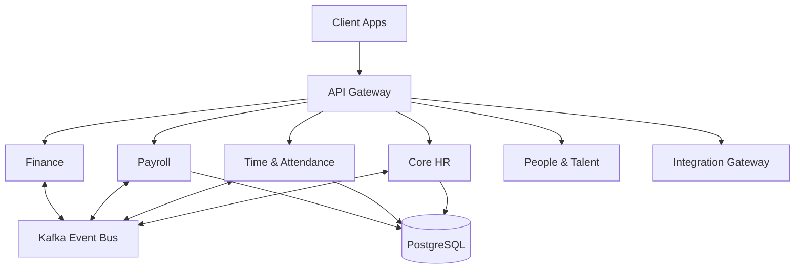

# System Architecture

> [!NOTE]
> **Stack Update Notice**: The actual current project stack has evolved to Next.js 15, React 19, Tailwind CSS 4, and ASP.NET Core 9 (instead of NestJS 10). The information below is based on the original specification.

## Architecture Pattern

The system follows a **Modular Monolith** architecture with Domain-Driven Design (DDD) boundaries. It is designed to be easily split into microservices in the future if needed.

The core domains (boundaries) include:
- Core
- People
- Time
- Payroll
- Finance
- Talent
- Comms
- Integration

## Multi-Tenant Isolation

Multi-tenancy is enforced at the database level using PostgreSQL Row-Level Security (RLS). Every table contains a `tenant_id` and `entity_id` column to ensure strict isolation between different tenants and entities within a tenant.

## Technology Stack

| Layer | Technology |
|---|---|
| **Frontend Web** | Next.js 14 (App Router), TypeScript, TanStack Query, Tailwind, shadcn/ui, React Hook Form + Zod, Recharts |
| **Mobile** | React Native (Expo) |
| **Backend** | NestJS 10 (TypeScript), REST + GraphQL (optional internal) |
| **Database** | PostgreSQL 16 + Prisma ORM |
| **Cache** | Redis 7 |
| **Event Bus** | Kafka (Alternative: RabbitMQ) |
| **Search** | OpenSearch / Elasticsearch |
| **Storage** | S3 / MinIO |
| **Authentication** | Keycloak (OIDC/SAML, MFA), Auth0 (Alternative) |
| **Secrets Management** | HashiCorp Vault / AWS Secrets Manager |
| **PDF/Export** | Playwright / Puppeteer |
| **Machine Learning** | Python FastAPI (for ATS ranking/timesheet anomaly detection) |

## DevOps & Observability

- **Containerization**: Docker
- **Orchestration**: Kubernetes (EKS/GKE/AKS for prod, Kind/minikube for dev)
- **Infrastructure as Code (IaC)**: Terraform + Helm
- **CI/CD**: GitHub Actions (build, test, SCA, IaC validate, deploy blue/green)
- **Observability**: Prometheus, Grafana, Loki, Sentry, OpenTelemetry
- **Testing Tools**: Jest/Supertest (API), Playwright (E2E), k6 (load), Trivy (image scan)
