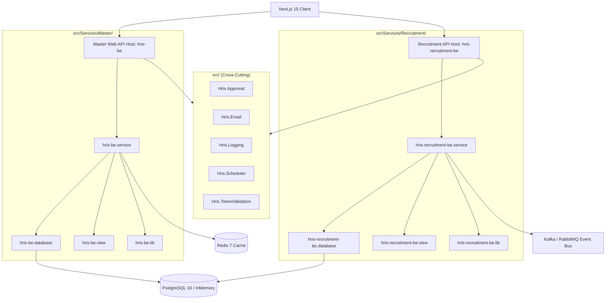

# System Architecture

## Architecture Pattern

The system follows a **Modular Microservice / Modular Monolith** architecture with Domain-Driven Design (DDD) boundaries, organized in `hris-backend/src/`. It is structured to run as a unified host in initial phases while allowing seamless deployment as independent microservices.

### Backend Project Layers (`eproc-be` Pattern)
Each domain module under `src/Services/<ServiceName>` (e.g. `Master`, `Recruitment`, `Payroll`) is decomposed into 5 dedicated projects:
1. **`*-be`**: Web API Host & API Controllers with auto-enabled Swagger documentation at `/swagger`.
2. **`*-be.database`**: EF Core `DbContext`, Domain Entities, `IBaseRepository<T>`, and `IUnitOfWork`.
3. **`*-be.service`**: Business logic services and application use cases.
4. **`*-be.view`**: View Models and Request/Response DTOs.
5. **`*-be.lib`**: Utility classes, `DefaultDtoResponse<T>`, and `DefaultDtoPagingParams`.



## Standard API Response & Pagination Format

All backend services standardize API responses using `DefaultDtoResponse<T>` and `DefaultDtoPagingParams` located in `hris-be.lib`:

```json
{
  "status": "SUCCESS",
  "data": [
    {
      "id": 1,
      "firstName": "John",
      "lastName": "Doe",
      "email": "john.doe@company.com"
    }
  ],
  "message": {
    "info": "Data retrieved successfully"
  },
  "total": 1
}
```

---

## Technology Stack

| Layer | Technology |
|---|---|
| **Frontend Web** | Next.js 15 (App Router), React 19, TypeScript, SWR, Tailwind CSS 4, Radix / shadcn/ui |
| **Backend API** | ASP.NET Core 9 (C#), REST, OpenAPI / Swagger |
| **Service Generator** | PowerShell CLI Generator (`pnpm create:service <ServiceName>`) |
| **Database** | PostgreSQL 16 + Entity Framework Core 9 |
| **Cache** | Redis 7 |
| **Event Bus / Worker** | MassTransit + RabbitMQ / Kafka |
| **Storage** | S3 / MinIO |
| **Authentication** | Keycloak (OIDC/JWT) |
| **Containerization** | Docker & Docker Compose |

---

## DevOps & Observability

- **Containerization**: Docker Multi-stage build
- **Orchestration**: Kubernetes (EKS/GKE/AKS for prod)
- **CI/CD**: GitHub Actions (`.github/workflows/ci-cd.yaml`)
- **Observability**: Serilog, Prometheus, Grafana
- **Testing Tools**: xUnit / NUnit (Backend), Jest + React Testing Library (Frontend)
