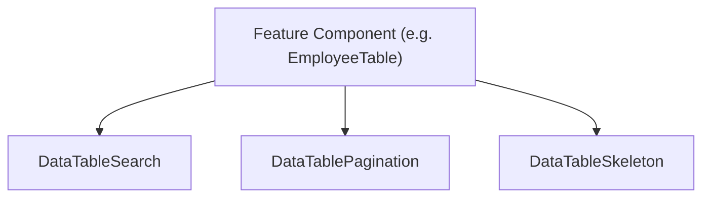

# Data Table Guide (Hybrid Composable Pattern)

This guide details the **Hybrid Composable Table** architecture implemented in `apps/web`. It outlines the architectural patterns and provides reference APIs and code blueprints for building both client-side and server-side paginated tables.

---

## 1. Architectural Philosophy

Instead of using a single monolithic `<DataTable />` component that tries to handle all variations of filtering, state management, SWR data-fetching, and dialog overlays, the frontend client follows a **composable hybrid pattern**:

1.  **Feature Containers (Orchestrators)**: Each feature component (e.g. `EmployeeTable`, `AnnouncementTable`) manages its own API hooks, local state for modals (create/edit/delete/view), and data sorting configurations. This preserves feature modularity and flexibility.
2.  **Shared UI Subcomponents**: Shared table behaviors, layouts, and input states are unified using lightweight, standardized subcomponents under `components/ui/`.



---

## 2. API References

### A. `DataTableSearch`
A text input with built-in search icon styling and debounced callback propagation.

```tsx
import { DataTableSearch } from "@/components/ui/data-table-search"

<DataTableSearch
  placeholder="Search employees..."
  value={search}
  onChange={setSearch}
  debounceMs={300}
  className="w-full max-w-sm"
/>
```

| Prop | Type | Default | Description |
| :--- | :--- | :--- | :--- |
| `value` | `string` | *Required* | Current state value of the search query. |
| `onChange` | `(val: string) => void` | *Required* | Callback triggered after the debounce timer expires. |
| `placeholder` | `string` | `"Search..."` | Optional placeholder text inside the input. |
| `debounceMs` | `number` | `300` | Delay in milliseconds before propagating updates. Set to `0` for instant client-side filtering. |
| `className` | `string` | `undefined` | Custom CSS wrapper class names. |

---

### B. `DataTablePagination`
A unified pagination toolbar displaying items range info and Next/Previous navigation buttons.

```tsx
import { DataTablePagination } from "@/components/ui/data-table-pagination"

<DataTablePagination
  page={page}
  totalPages={totalPages}
  totalItems={total}
  pageSize={pageSize}
  onPageChange={setPage}
  isLoading={isLoading}
  entityName="employees"
/>
```

| Prop | Type | Default | Description |
| :--- | :--- | :--- | :--- |
| `page` | `number` | *Required* | Current page (1-based index). |
| `totalPages` | `number` | *Required* | Total pages calculated by the server or client. |
| `totalItems` | `number` | *Required* | Total amount of elements across all pages. |
| `pageSize` | `number` | *Required* | Number of items shown per page. |
| `onPageChange` | `(page: number) => void` | *Required* | Trigger callback when clicking next/prev buttons. |
| `isLoading` | `boolean` | `false` | Disables paging buttons during SWR operations. |
| `entityName` | `string` | `"items"` | Plural noun to show in the footer label (e.g., "employees"). |

---

### C. `DataTableSkeleton`
Uniform placeholders to display animated row loads within the table body.

```tsx
import { DataTableSkeleton } from "@/components/ui/data-table-skeleton"

<TableBody>
  {isLoading ? (
    <DataTableSkeleton columnCount={7} rowCount={5} />
  ) : (
    // Render content rows...
  )}
</TableBody>
```

| Prop | Type | Default | Description |
| :--- | :--- | :--- | :--- |
| `columnCount` | `number` | *Required* | Number of mock columns/cells to create per row. |
| `rowCount` | `number` | `5` | Quantity of animated row skeletons. |

---

## 3. Code Blueprint: Client-Side Pagination

Use this blueprint when downloading the entire dataset at once and performing sorting, pagination, and query-filtering completely on the client.

```tsx
"use client"

import * as React from "react"
import { useToast } from "@/hooks/use-toast"
import { Button } from "@/components/ui/button"
import { Card, CardContent, CardHeader, CardTitle } from "@/components/ui/card"
import { Table, TableBody, TableCell, TableHead, TableHeader, TableRow } from "@/components/ui/table"
import { DataTableSearch } from "@/components/ui/data-table-search"
import { DataTablePagination } from "@/components/ui/data-table-pagination"
import { DataTableSkeleton } from "@/components/ui/data-table-skeleton"

// Types
interface Item {
  id: string
  name: string
  status: string
}

export function ClientSideTable() {
  const { toast } = useToast()
  
  // Data Fetching
  const [items, setItems] = React.useState<Item[]>([])
  const [isLoading, setIsLoading] = React.useState(true)

  // Filtering / Pagination states
  const [query, setQuery] = React.useState("")
  const [page, setPage] = React.useState(1)
  const pageSize = 10

  // 1. Process client-side filtering based on search state
  const filtered = React.useMemo(() => {
    const q = query.trim().toLowerCase()
    if (!q) return items
    return items.filter((item) => item.name.toLowerCase().includes(q))
  }, [items, query])

  // 2. Compute pagination values
  const totalPages = Math.max(1, Math.ceil(filtered.length / pageSize))
  const paginatedRows = React.useMemo(() => {
    const start = (page - 1) * pageSize
    return filtered.slice(start, start + pageSize)
  }, [filtered, page])

  // Reset page to 1 when filters change
  React.useEffect(() => {
    setPage(1)
  }, [query])

  return (
    <Card>
      <CardHeader>
        <CardTitle>Client Side Table</CardTitle>
        <DataTableSearch
          placeholder="Search items..."
          value={query}
          onChange={setQuery}
          debounceMs={0} // Instantly filters local memory array
          className="max-w-xs"
        />
      </CardHeader>
      <CardContent className="space-y-4">
        <div className="rounded-md border overflow-hidden">
          <Table>
            <TableHeader>
              <TableRow>
                <TableHead>ID</TableHead>
                <TableHead>Name</TableHead>
                <TableHead>Status</TableHead>
              </TableRow>
            </TableHeader>
            <TableBody>
              {isLoading ? (
                <DataTableSkeleton columnCount={3} rowCount={5} />
              ) : paginatedRows.length > 0 ? (
                paginatedRows.map((row) => (
                  <TableRow key={row.id}>
                    <TableCell>{row.id}</TableCell>
                    <TableCell>{row.name}</TableCell>
                    <TableCell>{row.status}</TableCell>
                  </TableRow>
                ))
              ) : (
                <TableRow>
                  <TableCell colSpan={3} className="text-center py-6 text-muted-foreground">
                    No records found.
                  </TableCell>
                </TableRow>
              )}
            </TableBody>
          </Table>
        </div>

        <DataTablePagination
          page={page}
          totalPages={totalPages}
          totalItems={filtered.length}
          pageSize={pageSize}
          onPageChange={setPage}
          isLoading={isLoading}
          entityName="items"
        />
      </CardContent>
    </Card>
  )
}
```

---

## 4. Code Blueprint: Server-Side Pagination

Use this blueprint when query, offset, limit, and sorting properties are delegated directly to the database API through SWR hooks.

```tsx
"use client"

import * as React from "react"
import { useEmployees } from "../api/use-employees" // Feature-specific SWR hooks
import { Card, CardContent, CardHeader, CardTitle } from "@/components/ui/card"
import { Table, TableBody, TableCell, TableHead, TableHeader, TableRow } from "@/components/ui/table"
import { DataTableSearch } from "@/components/ui/data-table-search"
import { DataTablePagination } from "@/components/ui/data-table-pagination"
import { DataTableSkeleton } from "@/components/ui/data-table-skeleton"

export function ServerSideTable() {
  const [search, setSearch] = React.useState("")
  const [page, setPage] = React.useState(1)
  const pageSize = 10
  const offset = (page - 1) * pageSize

  // Fetching data from API via SWR
  const { employees, total, isLoading } = useEmployees(offset, pageSize, search)
  const totalPages = Math.max(1, Math.ceil(total / pageSize))

  return (
    <Card>
      <CardHeader>
        <CardTitle>Employee List</CardTitle>
        <DataTableSearch
          placeholder="Search by name, department..."
          value={search}
          onChange={(val) => {
            setSearch(val)
            setPage(1) // Reset back to page 1 on search key changes
          }}
          debounceMs={300} // Prevent firing queries on every keystroke
          className="max-w-sm"
        />
      </CardHeader>
      <CardContent className="space-y-4">
        <div className="rounded-md border overflow-hidden">
          <Table>
            <TableHeader>
              <TableRow>
                <TableHead>ID</TableHead>
                <TableHead>Employee Name</TableHead>
                <TableHead>Role</TableHead>
              </TableRow>
            </TableHeader>
            <TableBody>
              {isLoading ? (
                <DataTableSkeleton columnCount={3} rowCount={5} />
              ) : employees.length > 0 ? (
                employees.map((emp) => (
                  <TableRow key={emp.id}>
                    <TableCell>#{emp.id}</TableCell>
                    <TableCell>{emp.firstName} {emp.lastName}</TableCell>
                    <TableCell>{emp.position}</TableCell>
                  </TableRow>
                ))
              ) : (
                <TableRow>
                  <TableCell colSpan={3} className="text-center py-6 text-muted-foreground">
                    No employees found.
                  </TableCell>
                </TableRow>
              )}
            </TableBody>
          </Table>
        </div>

        <DataTablePagination
          page={page}
          totalPages={totalPages}
          totalItems={total}
          pageSize={pageSize}
          onPageChange={setPage}
          isLoading={isLoading}
          entityName="employees"
        />
      </CardContent>
    </Card>
  )
}
```
